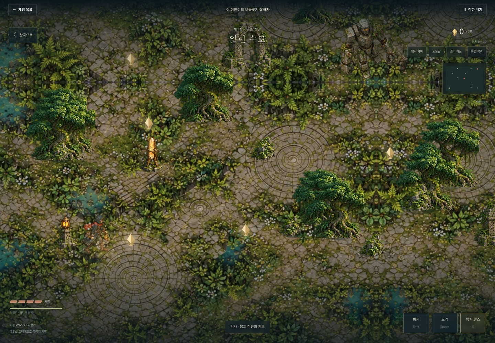

# 이안이의 보물찾기 잘하자

초등학교 4~5학년을 위한 탐험·유적 해독·수호자 전투 어드벤처. 망가진 왕국을 보물 100개로 복원한다는 이안이의 아이디어를, 왕국이 멈춘 이유를 추적하는 네 장의 이야기로 구성했다. 보물을 얻고 왕국으로 돌아오는 것이 복구와 서사 해독을 함께 진행시킨다.

## 네 장의 이야기

왕국의 심장이 멈춘 날 네 개의 균열이 생겼다. 마지막 기록은 “파괴가 아니었다. 누군가는 우리를 지키려 했다.” 네 세계에서 돌아오는 기록을 모으면 심장이 분산된 이유, 수호자들이 봉인을 지키는 이유, 같은 붕괴를 반복하지 않고 왕국을 되살릴 방법을 알게 된다.

| 장 | 탐사 구역 | 주제와 환경 |
|---|---|---|
| 잊힌 수로 | 공룡 정글 | 물길이 끊긴 유적, 수로 분출, 석조 수호자 |
| 침몰한 나침반 | 바다와 섬 | 지워진 항로, 밀려오는 조류, 철갑 선장과 심해 감시자 |
| 궤도 밖의 신호 | 우주 관측소 | 중앙 심장의 과부하 기록, 긴 도약을 지원하는 낮은 중력 |
| 다시, 왕국으로 | 거대한 정원 | 분산된 동력을 연결하는 생태계, 가시·뿌리, 마지막 봉인 |

세계마다 보물 25개와 수호자 2명이 있다. 25개를 왕국으로 가져오면 다음 장이 열린다. 각 장의 5·12·25개에서 세 개의 서사 기록을 해독하며 탐사 기록 메뉴에서 다시 읽을 수 있다. 원래의 제목과 세계 순서는 유지했다.

## 플레이

| 행동 | PC | 마우스·트랙패드·모바일 |
|---|---|---|
| 이동 | 방향키 / WASD | 지도에서 목적지 지정 / 방향 버튼 길게 누르기 |
| 도약 | Space | 도약 버튼 |
| 회피 | Shift | 회피 버튼, 행동력 소모·잠시 무적 |
| 조사·대화·탐지 | E | 상황에 맞게 바뀌는 조사 버튼 |
| 수호자 코어 공격 | 노출 상태에서 E | 코어 공격 버튼 |
| 전체화면 | 탐험 시작 시 진입, Esc 종료 | 전체화면·화면 복귀 버튼 |

일반 탐사 6개, 매몰된 기록 4개, 도약 5개, 장치 4개, 현장 임무 4개, 수호자 2개가 한 세계를 구성한다. 탐지 펄스로 매몰된 기록을 드러내고, 탐사대원 레온·세라·AL-7·이리스가 요청한 기록 조각 세 개를 모은 뒤 담당자에게 돌아간다.

장치는 네 가지 실제 조작 퍼즐이다. 회로 조각을 회전해 전원과 수신부를 연결하고, 여섯 문양의 신호를 기억해 재현하고, 동력 부품의 출력을 조합하고, 두 중계기를 거쳐 출구까지 경로를 만든다. 각 세계의 회전·신호·출력·경로 구성이 달라진다.

수호자는 방사파, 돌진, 교차 공격, 부채꼴, 뿌리, 구체 패턴을 사용한다. 경고 → 공격 → 코어 노출 상태가 분리되어 있고, 남은 체력이 절반 이하가 되면 경고 시간이 짧아진다. 중간 수호자는 체력 4, 최종 수호자는 6이다. 탐사자의 체력은 4이며 도약·회피·안전 구역으로 피할 수 있다. 쓰러져도 확보한 보물·임무는 보존되고 캠프에서 다시 출발한다.

## 실제 화면

## 시각·소리·전체화면

유아용 장난감 표현을 교체하고 풍화된 석재·청동·식물·빛을 중심으로 아트를 제작했다. 왕국의 폐허와 복구 장면을 별도로 만들고 복구량에 따라 전환한다. 환경·탐사자 보행·탐사대원·수호자는 자체 제작한 이미지 아틀라스에서 추출해 발 위치로 깊이를 정렬한다. 접지 그림자, 가리는 나무의 투명도, 랜턴 빛, 도약 높이, 탐지 파동, 공격 경고, 타격과 회수 입자를 함께 사용한다. 원본과 제작 프롬프트는 [아트 기록](../src/assets/treasure/README.md)에 있다.

HUD는 게임 장면 위의 가장자리에 배치했다. PC는 시작 버튼의 사용자 입력으로 Fullscreen API를 호출한다. 전체화면이 차단되어도 장면은 뷰포트를 채우며 수동 전체화면 버튼이 남는다. 모바일은 주소 표시줄 높이 변화에 대응하는 `100dvh`와 터치 방향·도약·회피·조사 버튼을 사용한다. 마우스 목적지 이동은 나무 충돌을 피하는 경로를 계산하며 방향키를 누르면 목적지 이동이 취소된다.

Web Audio로 낮은 환경음과 탐사·전투·복구 음을 합성한다. 첫 사용자 조작에서만 소리를 시작하며, 음소거·일시정지·창 이탈에 반응하고 게임을 나가면 정리한다. 외부 음악이나 폰트를 불러오지 않는다.

## 저장과 모듈 경계

- `src/lib/treasureContent.js`: 네 세계, 이야기, 보물·임무·환경 배치, 퍼즐과 판정.
- `src/lib/treasureKingdom.js`: 불변 시뮬레이션, 이동·충돌·경로, 행동력·체력·수호자·환경 위험, 저장 검증과 복구.
- `src/lib/treasureScene.js`: Phaser 렌더링·카메라·아틀라스·깊이·연출. 규칙은 시뮬레이션을 호출한다.
- `src/lib/treasureBridge.js`: React와 렌더러 사이의 명령·이벤트 경계. 프레임별 이동은 React 상태로 처리하지 않는다.
- `src/components/TreasurePuzzle.jsx`: 네 종류의 조작 퍼즐. 판정 함수는 콘텐츠 모듈에 있다.
- `src/pages/TreasureKingdom.jsx`: 세계 선택, 저장 연결, 기록·대화·복구·전체화면·HUD.

`ian-treasure-kingdom-v1`와 `ian-treasure-kingdom-v1-backup`에 두 저장본을 둔다. 보물 ID를 중복 제거하고, 실제 획득한 보물만 왕국에 전달할 수 있게 검증한다. 두 저장본 중 유효하고 revision이 큰 것을 선택한다. 이전 데이터는 기존 보물·왕국·위치를 유지하면서 새 임무 조각·탐지 필드를 초기화한다.

보물·수락한 임무·회수한 조각·탐지 결과는 즉시, 위치는 2초마다 또는 이탈·탐험 종료 때 기록한다. 미완료 수호자 전투는 재진입 시 처음부터 시작한다. 저장 실패는 안내와 재시도로 노출하고 현재 세션의 탐사는 계속된다. 클라우드 동기화는 없으며 브라우저 데이터를 지우면 기록도 지워진다.

왕국 복구는 가져온 보물 1·10·20·30·40·50·60·75·90·100개에서 관문·교량·거주지·교역 지구·수로·정원·관측탑·내성·세계 연결·왕국의 새로운 아침으로 진행된다.

## 버튼 클릭 후 키보드 조작

공통 `GameSession`에서 포인터 클릭으로 누른 게임 버튼은 포커스를 게임 영역으로 돌려준다. Tab/Enter로 선택한 버튼과 입력창·선택창·대화상자는 포커스를 보존한다. 기본 클릭·포인터 동작을 취소하지 않아 터치 길게 누르기와 기존 버튼 동작도 유지한다. 보물찾기의 이동 입력도 버튼에 포커스가 있을 때 방향키를 허용한다.

## 검증

- 단위 테스트 64개 통과. 100개 보물을 각 획득 규칙으로 회수하고 모든 복구 단계·저장·재개까지 시뮬레이션했다. 이전 저장 데이터, 저장 손상·차단·백업, 충돌·경로, 도약·회피·체력, 16개 퍼즐의 해답, 여덟 수호자와 여섯 공격 형태를 검사한다.
- 보물찾기 브라우저 테스트 80개와 공통 포커스 테스트 20개 통과. PC Chromium, Android 크기 Chromium, iPhone 크기 WebKit, 320px WebKit, 모바일 가로 Chromium을 사용했다. 실제 전체화면 진입, 이동·목적지 지정·도약·탐지, 네 퍼즐의 실제 조작, 임무 수락·조각 회수·복귀, 수호자 격파, 복구·새로고침, 저장 차단, 키보드·버튼 혼용을 검증했다.
- 공통 게임 회귀 테스트 131개 통과, 세로 전용 검사의 PC·가로 조건 2개 건너뜀. 모든 게임의 시작·입력·일시정지·재개·목록 복귀 및 기존 주요 회귀를 확인했다.
- `pnpm lint`, `pnpm test`, `pnpm build` 통과. Phaser 장면의 약 1.22MB / gzip 약 337KB 청크 크기 경고는 남아 있다. 해당 장면과 아틀라스는 탐험 시작 때 지연 로딩한다.

스크린샷은 실행 중인 게임에서 촬영했다. 브라우저 검증은 기기 에뮬레이션이며 실제 휴대폰 GPU·OS 제스처·이안이의 플레이 난이도 평가는 별도다. 공모전의 출품 규정과 심사 결과를 검증했다는 의미는 아니다.

## 적용한 스킬

2026-10-24 최신 공식 소스를 확인해 Anthropic `frontend-design-current`와 OpenAI Game Studio의 `game-ui-frontend`, `web-game-foundations`, `phaser-2d-game`, `game-playtest`를 사용자 전역에 설치했다. 이미지 제작에는 기본 `imagegen` 도구를 사용했다. 기존 플러그인 캐시는 덮어쓰지 않았고, 프로젝트의 React 19·Vite 7·JSX·CSS 규칙을 유지했다.

- [Anthropic 원본](https://github.com/anthropics/skills/tree/main/skills/frontend-design)
- [OpenAI Game Studio 원본](https://github.com/openai/plugins/tree/main/plugins/game-studio)
